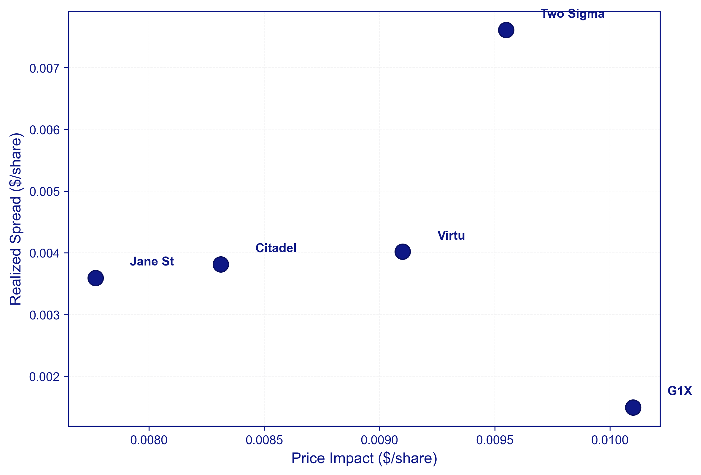

# Execution Quality of U.S. Equity Wholesalers (SEC Rule 605)

Code, results and figures from my bachelor thesis at LMU Munich (Institute for Financial Innovation & Technology, winter semester 2025/26):
**"Execution Quality in the U.S. Equity Market: A Comparative Analysis of the Top Five Wholesalers"**, graded 1.0 (the top grade in the German system).

## Question

Retail orders in the U.S. are mostly filled by a handful of wholesalers (Citadel Securities, Virtu, G1X Susquehanna, Jane Street, Two Sigma). Do the biggest firms, with their economies of scale, also give retail investors the best prices?

## Findings

Using monthly SEC Rule 605 reports for 2022–2023 (marketable orders, S&P 500 and Russell 2000 stocks):

- **Size does not buy quality.** Execution quality follows an *inverted U*: G1X Susquehanna, a mid-sized challenger, delivers higher effective-spread savings than market leaders Citadel and Virtu in every year and index segment.
- **Different liquidity models.** G1X has near-zero cancellation rates and absorbs higher price impact to win market share (*cross-subsidisation*). The incumbents cancel more and earn higher realised spreads, which is consistent with *cream-skimming*: selectively rejecting toxic flow.
- **Robust** to order-size buckets, market volatility (VIX), index membership and time (monthly stability tests).



## Method

- **Metric:** price-improvement capture (effective-spread savings scaled by the quoted spread), so that rows with very different share prices are comparable.
- **Tests:** one-sided Mann-Whitney U tests between wholesalers (the data is heavily skewed, so ranks are used instead of means), OLS of execution quality on market share, and correlation of execution quality with VIX and market returns.
- **Sample:** the five largest wholesalers by executed shares (about 189 bn shares), order-size buckets 100–9,999 shares.

## Repository layout

| Path | Contents |
|---|---|
| `src/thesis_data_analysis.py` | Main pipeline: loading and filtering Rule 605 data, all tables, statistical tests |
| `scripts/` | Supporting analyses (VIX/market correlations, spread widening, Dyhrberg et al. model replication) and figure generation |
| `data/` | S&P 500 / Russell 2000 constituent lists for index classification, monthly VIX |
| `results/` | Final result tables 1–8 as CSV |
| `figures/` | Figures used in the thesis |

## Reproducing

```bash
pip install -r requirements.txt
```

The raw Rule 605 dataset (`605_data.parquet`, ~1 GB, monthly market-center reports Jan 2022 – Dec 2023) is not included because of its size. Rule 605 reports are published monthly by each market center. Place the file in the working directory together with the CSVs from `data/`, then run:

```bash
python src/thesis_data_analysis.py
```

The plotting scripts in `scripts/` only need the result tables: copy `results/*.csv` into the working directory and run, for example, `python scripts/generate_academic_bw_plots.py`.

## Stack

Python · pandas · NumPy · SciPy · statsmodels · matplotlib / seaborn
